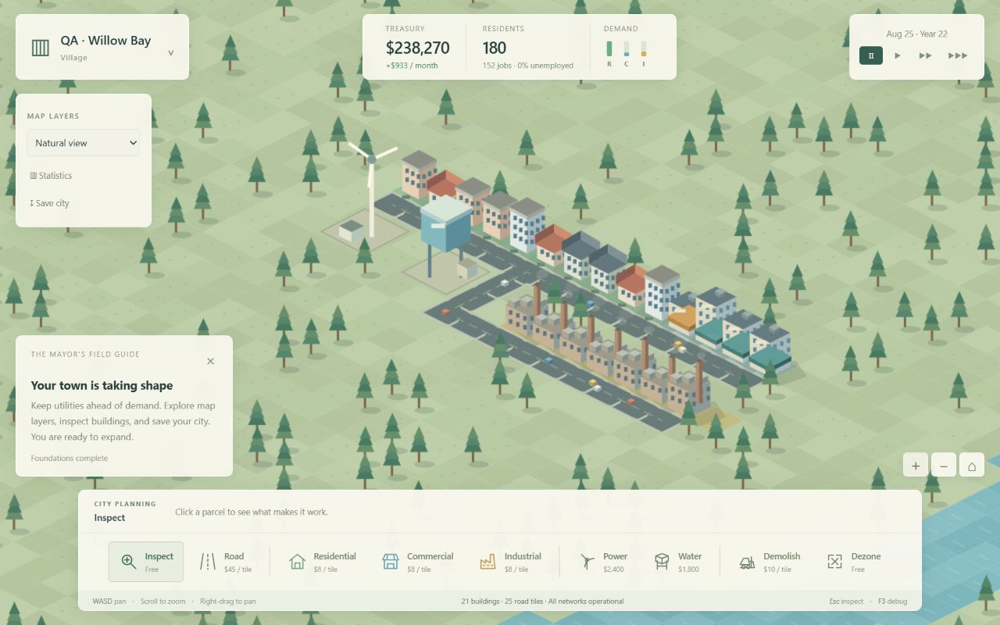

# Phase 1 — The city exists

Historical Phase 1 checkpoint, 2026-10-01. See [Phase 2](PHASE_2_REPORT.md) for the current build.

## Implemented

The complete foundation loop works from empty land: seeded terrain, camera,
roads/bridges, connected road graph, three zones, automatic construction and
building variation, statistical residents/workforce, employment, smoothed demand,
treasury, taxes, monthly accounts, connected power/water capacity, demolition,
fixed simulation days and speed controls, and save/load.

The interface includes a designed main menu, new-city setup, HUD, construction
dock, settings, building/utility/road inspectors, renaming, alerts, a skippable
field guide, monthly population/treasury/jobs charts, five data layers with
legends, founding/milestone/utility timeline entries, and F3 debug counters.

## Tested

`npm test`: **16 passed, 0 failed**. Tests execute deterministic terrain,
empty starts, atomic/affordable placement, malformed/out-of-bounds facility
footprints, bridge costs, shortest road paths, cache invalidation after
intersection demolition, development prerequisites, each RCI type, jobs and
income, disconnected utility networks, removal/recovery, taxation, accounting,
entity cleanup, capacity reservation, save → load → continue → save, checksum
and schema errors, and 2,400 simulation days of extreme taxes/debt.

Actual browser interaction, not headless state injection, verified:

- Founded an empty QA city, dragged roads and zoning, and placed utilities.
- Watched construction grow housing and commercial buildings.
- Created inaccessible industrial zones and observed 47% unemployment.
- Connected those parcels and observed industrial growth, **180 residents,
  152 jobs, 0% unemployment, and $933 projected net monthly cash flow**.
- Inspected actual road load and buildings; renamed a factory to “Foundry No. 7.”
- Saved slot 1, reloaded the application, loaded it, and saved slot 2.
- Imported a generated valid JSON fixture through the file chooser. It restored
  180 residents, utility supply, job capacity, and accounting successfully.
- Observed autosave metadata in the save manager during continued play.
- Changed taxes with the slider and retested immediate budget projection updates.
- Opened statistics and inspected monthly charts and workforce/utility values.
- Opened the traffic layer and verified routed-load colors and its legend.
- Tested zoom buttons, speed/pause controls, and the F3 debug display.
- Retested construction after enabling the scene cache: five new road tiles
  appeared immediately, charged $225, and correctly showed as unpowered on
  their isolated network. Connected facilities showed full footprint supply.
- Changed UI scale to 110% and reduced motion, reloaded, and verified both
  preferences persisted; restored defaults afterwards.

Visually inspected the main menu, new game, empty land, construction, developed
town, traffic overlay, inspector, budget, statistics, save manager, settings,
and debug view. Layout was inspected at **1280 × 800**, **1024 × 768**, and the
default narrow **615 × 672** app panel. DOM bounds confirmed clearance between
the smaller desktop toolbar, tutorial, and zoom buttons after fixing overlap.
Browser console checks returned no captured warning/error messages.

## Fixed

- Facility demolition mutated the tile reference before filtering the entity
  list, leaving invisible utility production and breaking save validation.
  Capture the facility ID first; retested removal, recovery, and serialization.
- Facilities now validate exact 2 × 2 footprints and demolition previews expand
  to the full footprint, including the actual tile cost.
- Flat parcel picking selected the street behind a building roof. Inspect mode
  now checks rendered building silhouettes first; retested factory selection.
- Budget totals stayed stale after moving tax sliders. Totals now refresh from
  remeasured income and expenses; verified a 9% → 10% change updated net income.
- Zoom controls overlapped the inspector; smaller viewport panels also intruded
  into the construction dock. Controls now share a safe bottom clearance and
  inspectors scroll within a bounded height.
- Tutorial panels obscured the debug readout; debug counters moved below the
  top HUD in the center of the viewport.
- Utility layers initially treated each facility tile's road adjacency separately,
  falsely marking the far side of a connected facility as disconnected. Layers
  now use the same facility component as the authoritative supply calculation.
- The restricted environment prevented Node's child-process test isolation.
  The native test runner now runs with `--test-isolation=none`.

## Performance

Observed headless results using Node **24.19.0**, constructed serviced fixtures,
360 simulation days per fixture. These are representative single-run timings,
not guaranteed frame times or population growth benchmarks.

| Initial residents | Buildings | Roads | Mean simulation day | Initial route calculation | Save | Load | Save size |
| ---: | ---: | ---: | ---: | ---: | ---: | ---: | ---: |
| 1,000 | 91 | 658 | 0.118 ms | 3.41 ms | 7.61 ms | 6.44 ms | 428 KB |
| 5,000 | 451 | 658 | 0.151 ms | 4.70 ms | 6.44 ms | 4.02 ms | 486 KB |
| 10,000 | 901 | 658 | 0.263 ms | 5.59 ms | 7.15 ms | 8.17 ms | 559 KB |

Routing is bounded to 120 sampled homes; visible traffic is bounded to 80 cars.
Graph caches are invalidated by edits and are rebuilt after loading. Canvas
initially repeated the entire terrain every frame: the running small town's
debug counter showed **22 FPS** at 1280 × 800. A state/camera-aware offscreen
scene cache increased the stationary render-loop counter to **179–188 FPS**
in the same in-app browser, with observed ticks around **0.10–0.30 ms**.
Environmental art refreshes at 12.5 Hz, while cars update every animation frame.
These counters are environment-specific callback rates, not guaranteed display
refresh rates. Camera changes still invalidate the scene; panning and larger
city rendering remain profiling targets. Large-map memory profiling is pending.

## Known issues and limits

- Traffic is the Phase 1 commute foundation. It follows actual roads and
  supplies actual load data, but congestion has no economic/travel-time effect yet.
- Building upgrades, services, pollution, deeper desirability, advanced transit,
  districts, freight, weather, and day/night are subsequent-phase scope.
- Early economy balance is generous and needs extended player feedback.
- The 56 × 56 map has not been validated at 25,000 or 50,000 residents.
- JSON export requests a browser download, but the in-app browser automation
  timed out waiting for its download event. File import and serialization work;
  a complete desktop-browser export/import round-trip is still unverified.
- No browser compatibility matrix, audio listening QA, or long-duration memory
  profile has been performed. Do not treat the benchmark as rendering evidence.

## Architecture changes

Selected dependency-free ES modules, Canvas 2D isometric art, and HTML/CSS UI.
The deterministic parcel grid and aggregate population remain separate from
rendering. Road components abstract utility distribution. BFS is appropriate
for the uniform road graph at this stage; advanced weighted roads can introduce
A* in Phase 3 without changing authoritative building state.

Saves store all authoritative state in checksum-protected versioned JSON;
runtime caches are derived. Local slots use browser storage and portable files
provide a backup. Important decisions are recorded in `ARCHITECTURE.md`.

## Next phase

First collect player feedback and stabilize Phase 1. The next major milestone
is **Phase 2 — The city works**: land value/desirability, services, education,
pollution, upgrades/decline, stronger traffic consequences, and deeper analysis.
No publishing or deployment has been performed.
