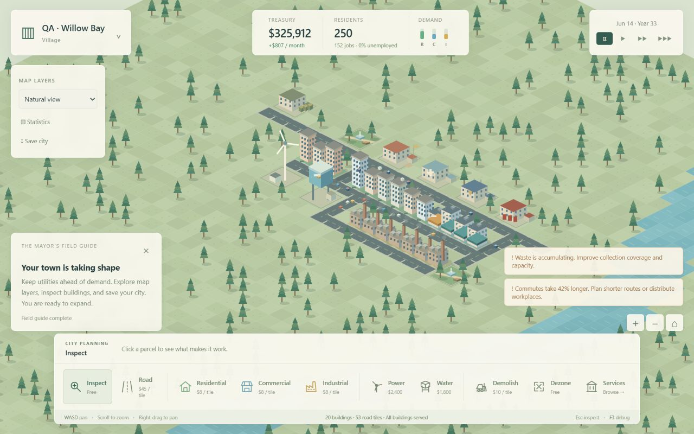
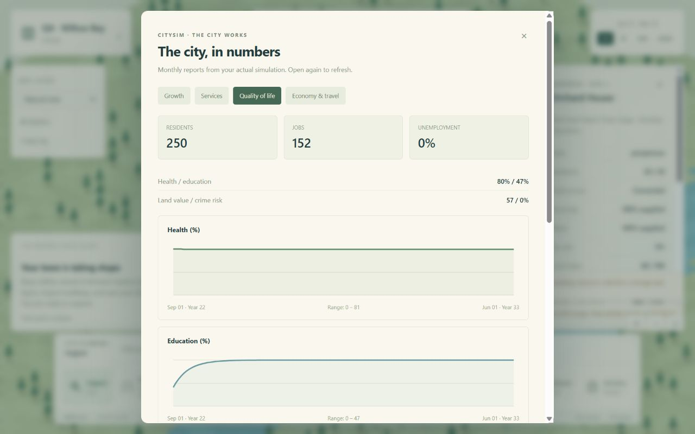

# Phase 2 — The city works

Completed checkpoint: version 0.2.0, 2026-10-01. Phase 3 has not started.

## IMPLEMENTED

- Land value and separate residential, commercial, and industrial desirability.
- Elementary and secondary schools, university, clinic, hospital, police,
  fire stations, waste depots, and neighborhood parks. Coverage follows roads,
  falls with distance, respects capacity, and requires operational utilities.
- Gradual education, health and crime indices, waste accumulation and collection,
  industrial and traffic pollution, persistent ground contamination, and noise.
- Three building levels with additional residents, jobs, utility demand, and
  taller artwork. Sustained poor conditions cause abandonment; restored conditions
  allow recovery. Inspectors explain the requirements for the next upgrade.
- Seeded fires, routed response, congestion-dependent dispatch arrival, fire
  damage, and recovery. Garbage, police, healthcare, and fire vehicles use actual
  municipal routes, with service-specific artwork.
- Traffic delay affects business productivity, demand, waste collection, and
  emergency arrival. Property revenue responds to land value and education.
- Seven population stages, facility unlocks, procedural facility naming,
  expanded alerts and tutorial, a service catalog, 18 additional data layers,
  and tabbed monthly statistics. Budgets separate service and utility maintenance.
- Version 2 saves retain civic state, contamination, and incidents. Valid Phase 1
  saves migrate automatically without losing their terrain, treasury, clock, or RNG.

## TESTED

`npm test`: **33 passed, 0 failed**. All JavaScript modules passed syntax checks.
An additional focused run confirmed the organic-upgrade test reaches level 3.

Automated checks cover the original foundation plus service unlocks, road-based
coverage, overloaded schools, disconnected service networks, parks and pollution,
ground contamination and decay, gradual education and waste collection, upgrades,
abandonment and reopening, protected versus unprotected fires, congestion effects,
station demolition during response, real service routes, observation purity,
deterministic save continuation, legacy migration, and malformed civic saves.

Actual browser interaction verified:

- Loaded an existing Phase 1 city; saved and reloaded it in Phase 2 slot 3.
- Built parks, garbage collection, school, clinic, police, and fire facilities.
- Observed a school with zero students because the connecting road detoured too
  far. Added a cross street and verified its assigned load rose to 25 / 150.
- Ran the city through organic growth to **250 residents and 152 jobs**, with
  **$807 projected monthly surplus**. Inspected a prosperous level 2 house with
  **30 / 30 residents, 88% health, and 52% education**.
- Verified the inspector correctly required Town status and more education for
  the next upgrade. Observed real remaining collection and congestion warnings.
- Checked coverage and pollution layers, service capacity statistics, quality-of-life
  history, maintenance breakdown, and tax projections. Industrial tax 9% → 10%
  changed projected surplus $807 → $849; restored 9% afterwards.
- Inspected layouts at 1280 × 800, 1024 × 768, and 615 × 672. The narrow service
  catalog uses one column; all ten toolbar buttons remain within the viewport.

## FIXED

- Service coverage could cross between separate road components touched by a
  facility. Coverage now uses the facility's operational network; regression tested.
- Service vehicles could take an unnecessary detour from the first facility
  entrance. Routes now choose the shortest reachable perimeter entrance.
- Removing a responding fire station could leave an invalid saved responder ID.
  Demolition now clears the dispatch reference immediately.
- Single-node commute routes could produce invalid vehicle animation positions.
  They contribute traffic load but are skipped by moving-vehicle rendering.
- Added levels required corrected capacity calculations, building hit regions,
  occupancy overlays, and save validation.
- Multiple alerts overlapped camera controls. Alerts now sit above those controls
  and hide while the inspector occupies the same area.
- The expanded benchmark initially exhausted its placement rectangle. It now
  uses valid road-adjacent parcels across the map and checks fixture population
  and save validity. Additional utilities keep the largest fixture operational.

## PERFORMANCE

Observed Node 24.19.0 results, 360 simulation days per constructed fixture:

| Initial residents | Buildings | Facilities | Roads | Mean simulation day | Initial measurement/routing | Save | Load |
| ---: | ---: | ---: | ---: | ---: | ---: | ---: | ---: |
| 1,000 | 91 | 92 | 702 | 2.551 ms | 14.71 ms | 6.75 ms | 4.51 ms |
| 5,000 | 451 | 92 | 702 | 4.356 ms | 10.09 ms | 8.05 ms | 6.59 ms |
| 10,000 | 901 | 92 | 702 | 6.183 ms | 9.71 ms | 10.42 ms | 7.32 ms |

Each fixture includes 60 civic facilities and 32 utility facilities. These are
stress layouts, not balanced cities: ending populations were 246, 2,791, and
7,417. Save sizes were approximately 482, 590, and 727 KB. Timings are single-run
headless observations, not frame-rate guarantees. Urban field calculation and
service coverage add work compared with Phase 1. Metrics caching, bounded route
samples, and the existing renderer scene cache remain in use.

## KNOWN ISSUES

- Traffic uses sampled commute flows and shortest road paths. Lane simulation,
  congestion-aware route choice, transit, freight, and advanced road types remain
  Phase 3 work. Animated service vehicles represent aggregate service activity;
  they are not individually persistent agents.
- Coverage assigns buildings to the strongest reachable provider before applying
  its capacity limit; overlapping providers do not dynamically rebalance loads.
- Economic balance remains generous in small established cities and needs player
  feedback. The 56 × 56 map has not been validated for 25,000–50,000 residents.
- Browser save/load and legacy migration were verified. A complete exported-file
  download/import round trip in a normal desktop browser remains unverified,
  as do broader browser compatibility, audio listening, and long-duration memory QA.

## ARCHITECTURE CHANGES

Added separate environment, services, evolution, incidents, and traffic modules.
The serializable city remains authoritative; measurement builds derived fields
without mutating it. A city revision invalidates cached metrics after simulation
changes. Service coverage uses bounded multi-source road searches, while dispatch
routes use reachable facility entrances. Schools, health, crime, and waste operate
on aggregate buildings and populations. Save version 2 explicitly validates the
new state and migrates version 1 after verifying its checksum and original schema.

## NEXT PHASE

**Phase 3 — The city moves:** advanced roads and intersections, deeper congestion,
buses and transit routes, freight and external trade, offices, density zoning,
districts, policies, and transport analysis. Stopped at this checkpoint for testing.
